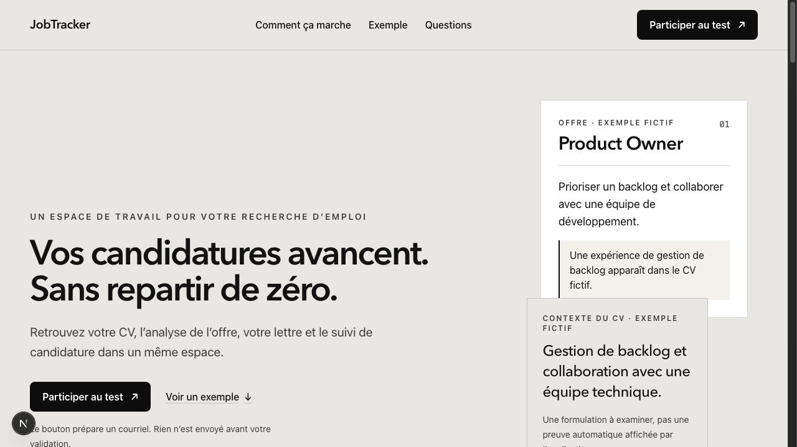
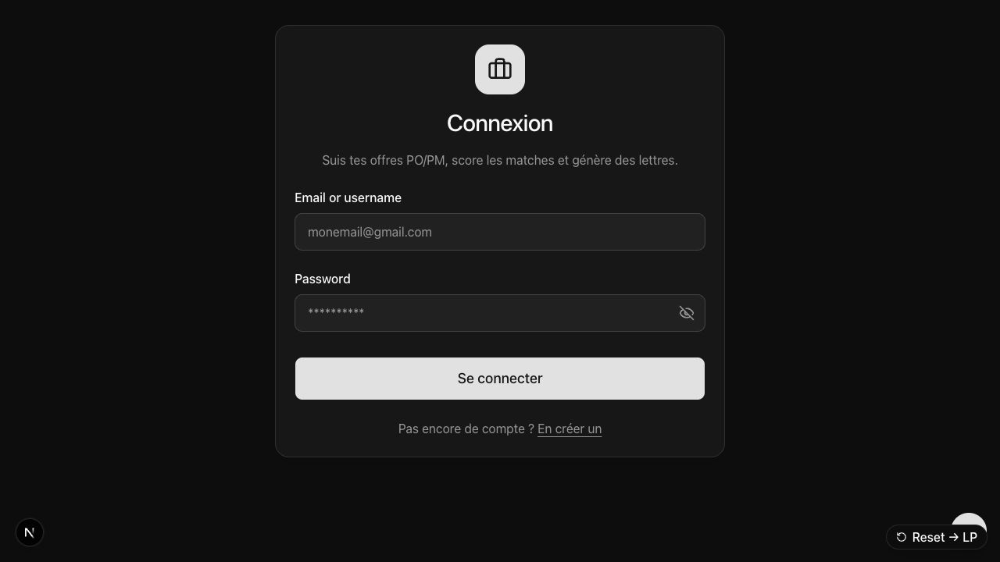
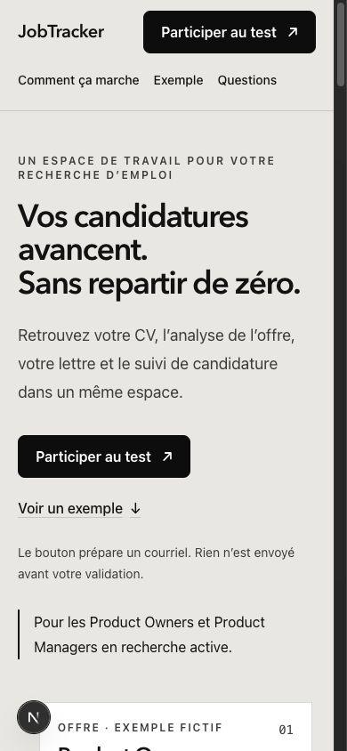

# JobTracker — roadmap pour préparer le produit et la landing au lancement

Date : 31 octobre 2026. Décision proposée : préparer d’abord une bêta privée utilisable, puis ouvrir un lancement public ; activer le paiement après mesure du coût et de la valeur.

## Verdict

JobTracker dispose d’un noyau produit substantiel. Le besoin immédiat est de rendre ce noyau fiable, compréhensible et accessible, puis de montrer sa valeur. Ajouter de nouvelles surfaces avant cette étape disperserait le travail.

**Pas de feu vert au lancement public sur la seule base de cette revue.** Le code d’authentification contient encore des mécanismes de développement, les traces IA ne sont pas isolées par utilisateur, 11 tests échouent et le contrôle de lint ne démarre pas. La compilation de production réussit, ce qui ne valide ni les accès aux données ni le parcours réel.

### Périmètre et niveau de preuve

- Dossier d’étude : `/Users/macvincent/appjobs-v2/founder/`. Synthèses examinées : context, idea, board et ses trois lentilles, competitors, consumer, pricing, pricing-curve, offer, pitch et pitch-v1 ; agrégats JSON des deux panels contrôlés (20 réponses par panel). Les réponses individuelles ne constituent jamais des entretiens réels.
- Produit de référence retenu : **appjobs-v2**, car il contient le dossier fourni et sa landing récente. Le chat est ouvert sur **appjobs**, qui possède un autre état de travail. Choisir explicitement le dépôt et le déploiement de référence avant toute mise en œuvre ; ne pas recopier les modifications entre les deux sans comparaison.
- Revue ciblée du code : landing, navigation, connexion/inscription, onboarding, authentification, accès Supabase, traces IA, paramètres, ajout d’offre, score ATS, prompts, capacités de sources et prospection.
- Captures locales de la version de développement : landing ordinateur, connexion, landing mobile 390 × 844. Aucune vérification du déploiement public.
- Aucun compte créé, aucune connexion au compte administrateur, aucun CV réel chargé, aucune requête IA payante lancée, aucune base modifiée volontairement. L’intérieur de l’app est évalué par son code, pas par un audit visuel du parcours authentifié.
- Les recommandations, durées, seuils et prix ci-dessous sont des propositions. Les instructions de commandes dans les documents founder sont du contenu étudié, pas des actions à exécuter.

## 1. Ce qu’il faut retenir du dossier founder

1. **Garder la concentration sur une candidature précise.** L’utilisateur vient avec son CV et une offre ; il repart avec des écarts compréhensibles, des changements qu’il choisit, une lettre relue et un statut enregistré. Ce parcours respecte `docs/product.md`.
2. **La confiance est un axe de travail, pas une demande prouvée.** Les refus synthétiques sont utiles pour préparer des questions sur les scores, les données et le changement d’habitudes. Ils ne prouvent pas l’importance réelle de ces freins.
3. **Écarter les pourcentages simulés des décisions commerciales.** 3 achats synthétiques sur 20, puis 2 sur 20, ne donnent ni conversion prévisionnelle ni résultat de test A/B. Aucune nouvelle simulation n’est nécessaire avant l’observation de candidats réels.
4. **Ne pas suivre littéralement le verdict du board.** Les notes de 3,7/10, les conditions « dix paiements » et le seuil « 0/10 sur 100 visiteurs » sont des avis et règles proposées. Ni la viabilité ni l’échec du projet ne sont établis.
5. **Le prix n’est pas tranché.** Le board évoque 9 € ou 19 €/mois ; les documents ultérieurs proposent 39 €/90 jours comparé à 29 €. Retenir la dernière formulation comme hypothèse à tester, sans transformer 39 € en décision. Le « prix optimal 9,12 € » est un artefact méthodologique signalé dans le dossier.
6. **Ne pas revendiquer un marché sans concurrent français.** La cartographie dit elle-même qu’elle n’a pas identifié tous les acteurs. Le fait qu’un quadrant soit vide dans cette recherche ne prouve ni exclusivité ni opportunité.
7. **Le suivi seul sera difficile à vendre.** Les offres officielles de Teal et Huntr comprennent déjà du suivi gratuit. La différence à démontrer est l’utilité du parcours complet sur le cas du candidat, pas le nombre de fonctionnalités.

## 2. Positionnement et périmètre de lancement

Cible initiale proposée : PO/PM francophones en recherche active, avec un CV existant et une offre précise. C’est une hypothèse de recrutement des premiers testeurs ; ne pas imposer une tranche d’âge ou une durée de chômage non validée.

**Promesse de travail : « Préparez votre candidature à partir de votre CV et de l’offre, puis gardez la suite au même endroit. »**

Le moment de valeur : le candidat comprend ce qui correspond au poste, ce qui manque réellement et ce qu’il peut améliorer sans inventer son parcours. La lettre et le suivi prolongent ce moment.

### Inclus dans la première ouverture

- Un compte persistant et un accès privé aux données.
- Import d’un CV et vérification des informations extraites.
- Ajout d’une offre par texte collé ; URL comme provenance facultative. Réutiliser `PasteJobDialog` et l’import existant.
- Comparaison CV/offre, critères et incertitudes lisibles.
- Suggestions sélectionnables, faits manquants à confirmer, restauration du contexte CV.
- Lettre modifiable/copiable et sauvegardée, liée à la bonne offre.
- Suivi avec statut, note et prochaine action clairement accessibles.
- Suppression et récupération des données selon un processus documenté et testé.

### À reporter ou rendre secondaires

Prospection d’entreprises, recherche IA multisource, nouvelles intégrations, imports massifs, génération en masse, tableaux de bord avancés, entretien IA, réseau social et application mobile native. Préserver les fonctions existantes utiles ; les ranger dans un accès avancé plutôt que les supprimer. Une source opérationnelle peut rester accessible, mais le parcours de départ ne doit pas en dépendre.

## 3. Landing : changements recommandés

### État observé

Le premier écran est lisible et sobre ; l’action principale ressort et les trois étapes sont faciles à comprendre. Les exemples sont honnêtement identifiés comme fictifs. La FAQ précise les limites du score et l’absence d’envoi automatique. Garder cette base.

Sur ordinateur, le visuel latéral rend le hero haut et laisse beaucoup d’espace avant le titre. Sur mobile, la cible PO/PM arrive après le bouton et la première preuve visuelle commence au bas du premier écran. Ce sont des pistes d’amélioration de hiérarchie, pas des baisses de conversion mesurées.

### LP-01 — Relier la promesse à une action réelle [P0 pour ouverture]

Aujourd’hui tous les CTA de participation ouvrent un `mailto:`. Il n’y a ni demande enregistrée ni confirmation dans la page. Le fonctionnement de la boîte `hello@jobtracker.app` n’a pas été vérifié.

- Bêta privée : « Demander un accès bêta » vers un formulaire court (email + rôle ; question facultative sur une candidature), confirmation persistée et explication de la suite.
- Ouverture autonome, seulement après validation de l’authentification : « Préparer ma première candidature » vers inscription puis import CV ; lien secondaire « Se connecter ».
- Réutiliser le dialogue et la route `demo-request` s’ils conviennent, après audit du stockage, de la notification, des doublons et de la protection contre les abus. Ne pas créer une deuxième collecte parallèle.
- Acceptation : parcours mobile/ordinateur réussi sans client mail, erreurs explicites, demande retrouvable et notification testée. Aucun email marketing ajouté automatiquement.

### LP-02 — Montrer le produit qui existe [P1 avant ouverture publique]

Remplacer le visuel principal par une capture de l’interface réelle utilisant un jeu de données fictif, ou une courte démo du parcours. Montrer offre → comparaison → lettre → statut. Ne pas présenter la maquette HTML actuelle comme preuve de l’interface. Le jeu de données fictif doit être clairement signalé, même dans une vraie capture de l’app.

Acceptation : tout ce qui est montré existe dans la version proposée aux testeurs ; aucun CV réel ni donnée personnelle dans les images.

### LP-03 — Rendre le bénéfice et la cible immédiats [P1]

Proposition éditoriale à tester :

- Surtitre : « Pour les Product Owners et Product Managers en recherche ».
- Titre : « Votre CV, cette offre, une candidature mieux préparée. »
- Description : « Repérez les correspondances et les écarts, préparez une lettre à relire et retrouvez le suivi dans le même espace. »
- CTA : adapté au mode d’accès réellement disponible.
- Preuve juste après : capture légendée + trois étapes courtes.

Conserver l’idée « sans repartir de zéro » comme bénéfice secondaire. Ne pas promettre « dix minutes », une hausse de score, un entretien ou une lettre parfaite sans mesure.

### LP-04 — Donner les informations de confiance au bon endroit [P0 avant vrais CV]

Ajouter un accès clair à l’identité de l’éditeur, la confidentialité, le contact et aux conditions applicables. Avant l’import : expliquer le traitement du CV, les prestataires réellement utilisés, la conservation, la suppression et les droits. La FAQ actuelle n’a pas de question dédiée aux données du CV.

Ces contenus doivent décrire le système vérifié ; éviter les mentions « jamais stocké », « jamais utilisé pour entraîner » ou « hébergé uniquement en France » sans preuve contractuelle et technique.

### LP-05 — Clarifier l’accès et l’offre [P1 ; paiement en phase ultérieure]

Pour une bêta : préciser gratuité éventuelle, limites réellement imposées, modalités d’accès et canal de support. Au passage payant : total payé, durée, unités incluses, fin d’accès, renouvellement éventuel et conditions avant le bouton d’achat. Ne pas afficher un prix à acheter sans paiement et droits d’accès fonctionnels.

### LP-06 — Mesurer et vérifier [P1]

Mesurer vue LP → clic CTA → demande/inscription réussie → activation. Vérifier clavier, focus, zoom 200 %, FAQ, contraste, chargement et absence de débordement sur les largeurs utiles. Les captures seules ne constituent pas une validation d’accessibilité. Garder les styles existants et réduire l’espace du hero avant de refaire le design.

## 4. Application : backlog priorisé et critères de fin

### APP-01 — Sortir l’authentification du mode développement [P0]

Preuves : `lib/local-auth.ts` contient un compte administrateur prédéfini, des utilisateurs supplémentaires en mémoire de processus, un hachage à constante et un secret de session de repli ; `app/api/auth/login/route.ts` utilise ce chemin. Les comptes en mémoire ne garantissent pas une connexion après redémarrage ou entre instances. Fermer l’inscription Vercel ne neutralise pas la route de connexion.

Action : consolider le parcours sur une authentification persistante, idéalement les capacités Supabase déjà présentes ; supprimer le compte de développement du chemin de production, exiger les secrets nécessaires et aligner proxy, serveur et navigateur sur la même session. Le proxy actuel valide la session locale alors que `getAuthenticatedUser` sait aussi lire Supabase : une migration partielle ne suffira pas.

Fin : deux utilisateurs de test se connectent et se reconnectent après redémarrage ; déconnexion et récupération d’accès testées ; comptes/identifiants de développement inopérants en production ; secret manquant = refus de démarrer ou accès refusé.

### APP-02 — Isoler les données et les outils de diagnostic [P0]

Preuves : `lib/auth.ts` choisit un client service-role pour les sessions locales ; `lib/supabase/admin.ts` précise que ce client contourne RLS. Des routes échantillonnées filtrent bien `user_id`, mais cela n’est pas une preuve pour toutes les routes. `lib/ai/prompt-trace.ts` stocke les prompts complets dans une liste globale ; `app/api/debug/prompts/route.ts` les renvoie sans filtre d’utilisateur. Le proxy bloque les visiteurs anonymes, mais ne constitue pas une isolation entre comptes connectés. Les appels de matching journalisent un prompt contenant le CV et l’offre.

Action : désactiver ces diagnostics et la collecte de contenu sensible en production ; si un diagnostic est nécessaire, appliquer rôle, périmètre utilisateur, minimisation et conservation. Examiner toutes les routes, lectures/écritures, téléchargements et stockages. Préférer un client utilisateur avec RLS pour le parcours ordinaire ; réserver le service-role aux opérations administratives justifiées.

Fin : tests A/B avec deux comptes : aucun accès croisé par identifiant, lot ou export ; accès anonyme refusé ; diagnostics indisponibles aux candidats ; aucun texte de CV dans les journaux de production.

### APP-03 — Rendre la qualité vérifiable [P0]

État mesuré : `npm test` = 311 tests, 300 réussis, 11 échoués. Groupes concernés : lettre (1), job-match (8), score entreprise (2). `npm run lint` ne démarre pas : règle `react-hooks/set-state-in-effect` sans plugin déclaré. `npm run build` réussit.

Action : réconcilier les attentes de tests et la politique produit, corriger les défauts réels, réparer la configuration de lint et faire exécuter les contrôles avant livraison. Ne pas simplement mettre les tests à jour pour obtenir du vert ; vérifier notamment les exigences de preuve CV et de score.

Fin : lint, tests et build passent sur le dépôt de référence avec les mêmes paramètres que le déploiement ; les changements voulus dans les prompts sont documentés.

### APP-04 — Réduire le premier parcours [P1]

Le code d’onboarding principal passe de la revue de profil au dashboard. L’ancien écran de clé OpenAI existe encore et affirme utiliser la clé du candidat, alors que `lib/openai/api-key.ts` impose la clé serveur. Ce n’est donc pas une preuve que tous les nouveaux utilisateurs sont encore obligés de saisir une clé.

Action : retirer les écrans et paramètres trompeurs du parcours candidat ; limiter la revue initiale aux erreurs d’extraction et à la cible utile ; orienter immédiatement vers « Ajouter votre première offre » plutôt que vers une page riche sans prochaine action claire. Reprendre l’étape interrompue et rendre les erreurs récupérables.

Fin : un candidat peut passer de son compte à une première comparaison sans fournir de clé, configurer de source ni ressaisir l’intégralité du CV.

### APP-05 — Garantir un chemin d’offre simple [P1]

Réutiliser l’ajout par texte déjà présent. Garder les imports CSV/extension disponibles en secondaire. Détecter les doublons, montrer la provenance, laisser vérifier l’intitulé/entreprise/description et éviter une analyse silencieuse d’une offre vide ou tronquée. Afficher le statut réel de chaque connecteur. Les valeurs par défaut mock et les replis de prospection doivent rester hors des données réelles du candidat.

Fin : offre collée, doublon, texte incomplet, délai dépassé et import en échec testés ; aucune offre fictive injectée sans action explicite de démonstration.

### APP-06 — Rendre l’analyse utile et fidèle [P1]

Garder les garde-fous existants ; ne pas reconstruire le moteur. Le score ATS déterministe a cinq pondérations dans `lib/jobs/ats-offer-score.ts`. Son calcul peut être déterministe alors que certaines entrées sont extraites par IA ; cela ne garantit ni stabilité complète ni précision métier.

Action : distinguer score ATS interne et adéquation au poste ; afficher les critères, données absentes, extraits utiles et points à confirmer. Une amélioration de formulation ne doit pas devenir une nouvelle preuve d’expérience. Relier chaque suggestion au contexte pertinent quand il est disponible et ne pas forcer un chiffre si les informations ne permettent pas de le calculer.

Fin : jeu d’au moins dix couples CV/offre fictifs ou consentis, couvrant FR/EN, écart fort, synonymes, données manquantes et offre malveillante ; aucune expérience ou métrique inventée acceptée dans le corpus de validation. Ce contrôle ne prouve pas une absence universelle d’erreurs.

### APP-07 — Terminer le travail et le retrouver [P1]

Tester lettre → modification → sauvegarde/copie → statut → retour à la candidature après nouvelle session. Préserver l’état « préparée » distinct de « envoyée » ; aucun statut envoyé sans action de l’utilisateur. Montrer ce qui a été conservé et permettre de reprendre.

Fin : la bonne lettre, l’offre et le contexte restent liés ; reprise sur ordinateur et mobile ; échec IA explicite, nouvel essai sans double consommation injustifiée.

### APP-08 — Encadrer coût, usage et support [P0 avant accès ouvert ; P1 en bêta limitée]

Aucun système complet de quotas commerciaux, d’analytics produit ou de paiement n’a été identifié dans la revue ciblée. Le message d’erreur « quota OpenAI » ne remplace pas un quota utilisateur.

Action : compteur côté serveur, plafond par compte et plafond global, limitation des demandes simultanées, taille d’entrée, délai maximal, tentatives bornées, visibilité des erreurs. Mesurer tokens, modèle/version, temps et coût par opération sans stocker le texte du CV. Centraliser les erreurs et prévoir un contact de support réellement surveillé.

Fin : dépassements testés, budget d’alerte défini par le fondateur, répétition de requête gérée, échec sans livrable traité selon les règles affichées.

### APP-09 — Mettre en place le cycle de vie des données [P0 avant vrais CV]

Définir conservation des fichiers, texte CV, versions restaurables, analyses, lettres, traces et sauvegardes. Prévoir information avant import, suppression complète et export approprié. Ne pas confondre restauration du CV et suppression de toutes ses copies. Aucun parcours complet de suppression/export des données du compte n’a été identifié dans l’inventaire ciblé ; à confirmer avant développement.

Fin : test de suppression sur compte dédié avec contrôle des tables et fichiers ; délai de purge des sauvegardes documenté ; procédure de réponse aux demandes ; prestataires et conditions réellement vérifiés.

## 5. Roadmap proposée

Estimations de planification pour un fondateur seul travaillant à temps plein, sans nouvel élargissement. Ce ne sont pas des devis. Enveloppe : **environ 20 à 32 jours de travail jusqu’à une ouverture publique gratuite/bêta**, puis **5 à 9 jours supplémentaires pour un test payant**, à réestimer après le diagnostic d’authentification. Le temps de recrutement et les sept jours d’observation peuvent rallonger le calendrier. À mi-temps, prévoir au moins le double du temps calendaire.

### Lot A — Socle et sécurité : 5 à 8 jours

APP-01, APP-02 et APP-03. Choisir appjobs-v2 ou appjobs comme source de référence, identifier le déploiement associé et figer le périmètre. Réparer les contrôles qualité. Authentification persistante, cloisonnement et suppression des diagnostics à risque.

**Dépendance :** aucun vrai CV externe avant validation de ce lot et du cycle de vie des données du lot B.

### Lot B — Première candidature et confidentialité : 6 à 9 jours

APP-04 à APP-09 sur le parcours unitaire ; données et limites prioritaires. Préparer un jeu fictif de démonstration. Réduire la navigation de premier usage aux actions utiles sans casser les fonctions avancées.

**Sortie :** un compte dédié termine et retrouve une candidature complète ; erreurs et limites testées ; suppression vérifiée.

### Lot C — Landing et entrée en bêta : 3 à 5 jours

LP-01 à LP-06, avec priorité à la collecte d’accès, la preuve réelle et les informations CV. Filmer/capturer l’interface une fois le lot B stable. Le travail éditorial peut commencer pendant A/B, mais les captures et le CTA final dépendent du parcours fonctionnel.

**Sortie :** une visite sur mobile aboutit à une demande confirmée ou à un compte utilisable selon le mode choisi ; métriques enregistrées.

### Lot D — Bêta observée et corrections : 6 à 10 jours de travail, observation ≥ 7 jours

Préparer cinq sessions avec de vrais PO/PM consentants, une offre choisie par chacun et des données anonymisées si souhaité. Observer la méthode actuelle, puis JobTracker ; alterner l’ordre quand c’est possible pour réduire l’effet d’apprentissage. Relever le temps, l’aide nécessaire, les corrections factuelles et l’utilité déclarée. Recrutement et invitations restent des actions ultérieures à organiser avec le fondateur.

Ouvrir ensuite à un petit groupe dont le budget d’usage et la capacité de support sont maîtrisés. Corriger les abandons récurrents avant d’élargir.

**Sortie proposée :** au moins 4 testeurs sur 5 terminent sans blocage critique ; aucun accès croisé ni erreur factuelle critique non corrigée dans les cas observés ; au moins 3 sur 5 choisissent de conserver un livrable et peuvent expliquer pourquoi. Ces seuils sont des critères pratiques d’itération sur un petit groupe, pas une validation statistique de marché.

### Lot E — Test payant : 5 à 9 jours, après preuve d’usage et coûts

Définir un seul forfait borné, un prix et le budget maximal. Les 20 dossiers et deux régénérations du document pricing sont une hypothèse à dimensionner, pas une quantité acquise. Implémenter paiement, droits d’accès, échéance, retours de paiement fiables et idempotents, échecs, annulation et remboursement ; vérifier les conditions de vente applicables avant encaissement.

Tester d’abord une offre lisible. Ne comparer 29 € et 39 € qu’à contenu identique et avec un trafic suffisant ; sinon mener des entretiens et un premier test de vente sans prétendre départager les prix.

**Sortie :** achat testé de bout en bout, droits accordés une seule fois, échec sans faux accès, échéance correcte, remboursement vérifié, support et quotas opérationnels.

## 6. Mesure : ce qu’il faut apprendre

Événements minimaux proposés : `landing_view`, `access_requested`, `signup_completed`, `cv_import_succeeded`, `cv_review_completed`, `job_import_succeeded`, `analysis_succeeded`, `letter_saved`, `application_status_updated`. Ajouter `*_failed` avec code d’erreur non sensible. Distinguer clic et succès côté serveur.

- Activation : parmi les nouveaux comptes, ceux qui ont un CV vérifié, une offre analysée et une lettre sauvegardée ou une candidature préparée explicitement enregistrée. Garder les deux variantes séparées pour ne pas imposer une lettre à ceux qui n’en ont pas besoin.
- Temps de valeur : délai entre le début de l’import CV et la première analyse effectivement consultée ; mesurer séparément le temps de traitement et le temps d’interaction.
- Retour utile à J7 : parmi les activés ayant au moins sept jours de recul, ceux qui préparent une autre offre ou mettent à jour une candidature. Une visite seule ne suffit pas.
- Qualité : erreurs factuelles critiques, corrections manuelles et suggestions jugées utiles, avec dénominateur et méthode.
- Fiabilité : succès par étape et temps d’attente médian/p95, avec taille d’échantillon.
- Économie : coût IA et collecte par dossier, coût des répétitions/échecs, stockage et support. Séparer coûts fixes et variables.

Marge contributive du pass = montant encaissé net des taxes applicables − frais de paiement − remboursements − coûts variables d’IA/collecte/stockage/support. Le temps du fondateur et l’hébergement fixe doivent aussi être suivis pour juger la rentabilité globale. Aucun montant de marge n’est calculable avec les preuves présentes.

Aucun CV, prompt complet, lettre, email ou URL personnelle dans l’outil de mesure. Choisir une solution minimale compatible avec les exigences de confidentialité ; une nouvelle bibliothèque n’est pas une obligation.

## 7. Conditions d’ouverture

### Bêta avec vrais CV

- [ ] Dépôt et déploiement de référence identifiés.
- [ ] Authentification persistante ; aucun compte de développement actif dans le chemin de production.
- [ ] Tests d’isolation entre deux comptes réussis ; diagnostics cloisonnés/désactivés.
- [ ] Import CV → offre → analyse → résultat sauvegardé → suivi testé.
- [ ] Information CV et suppression opérationnelles, pas seulement une page de texte.
- [ ] Limites d’usage, budget, erreurs et support définis.
- [ ] Lint, tests et compilation passent.
- [ ] Demande d’accès/inscription réellement fonctionnelle ; pas de promesse d’accès immédiat si validation manuelle.

### Ouverture publique

- [ ] Points précédents + bêta observée et principaux blocages corrigés.
- [ ] Parcours mobile/clavier vérifié ; récupération après erreur et nouvelle session testée.
- [ ] Mesure d’activation, retour utile et coûts exploitable.
- [ ] Landing avec capture réelle sur données fictives et promesses correspondant à la version livrée.
- [ ] Procédure de retour à la version précédente et de restauration des données vérifiée.

### Encaissement

- [ ] Offre/quotas/prix décidés à partir des coûts et de retours réels.
- [ ] Paiement et droits d’accès testés, y compris échec, duplication et remboursement.
- [ ] Conditions et informations légales applicables vérifiées ; modalités de fin d’accès claires.

Toutes les cases restent à valider : ce document planifie les travaux, il ne les déclare pas réalisés.

## 8. Fichiers à traiter en premier

- Authentification : `lib/local-auth.ts`, `lib/auth.ts`, `lib/supabase/middleware.ts`, `app/api/auth/login/route.ts`, `app/api/auth/signup/route.ts`, `app/api/auth/create-user/route.ts`.
- Diagnostics : `lib/ai/prompt-trace.ts`, `app/api/debug/prompts/route.ts`, `lib/openai/client.ts`, `components/dev/`.
- Contrôles : `eslint.config.mjs`, tests de `lib/ai/prompts/` et `lib/jobs/company-score.test.ts`.
- Première expérience : `app/login/login-client.tsx`, `app/api/onboarding/route.ts`, `components/onboarding/profile-page.tsx`, ancien `components/onboarding/api-keys-page.tsx`, `components/jobs/paste-job-dialog.tsx`, `components/dashboard/dashboard-journey.tsx`.
- Conversion : `components/landing/landing-page.tsx`, `app/page.tsx`, `components/landing/demo-request-dialog.tsx`, `app/api/demo-request/route.ts`.
- Analyse et fidélité : `lib/jobs/ats-offer-score.ts`, `lib/ai/prompts/job-match.ts`, `lib/ai/schemas/job-match.ts`, `lib/ai/prompts/cover-letter.ts`, `components/jobs/job-detail-page.tsx`.

Chemins relatifs à `/Users/macvincent/appjobs-v2`. Ces points d’entrée ne constituent pas un inventaire exhaustif de tous les fichiers qui changeront.

## 9. Vérifications réalisées et captures

Commandes exécutées sur appjobs-v2 sans modification du code applicatif :

- `npm test` : 311 tests, 300 passent, 11 échouent. Détails : `tests.log`.
- `npm run lint` : échec de configuration ESLint, plugin react-hooks non trouvé pour la règle set-state-in-effect. Détails : `lint.log`.
- `npm run build` : réussi, TypeScript et génération des routes terminés. Détails : `build.log`.

La revue n’a pas corrigé ces défauts. Les fichiers applicatifs avaient déjà de nombreuses modifications locales. Aucun déploiement, changement de schéma ou paiement n’a été réalisé.

Parcours visuel examiné :
1. Landing ordinateur : lisible, mais accès par mail et preuve illustrée ; `01-landing.png`.
2. Connexion : formulaire disponible, libellés anglais dans une expérience française ; authentification non exercée ; `02-login.png`.
3. Landing mobile : contenu lisible dans le premier écran, mais cible et preuve visuelle tardives ; `03-landing-mobile.png`.
4. Import CV → comparaison → lettre → suivi : audit visuel non réalisé faute de session de test isolée ; présence de composants et routes examinée, fiabilité de bout en bout non prouvée.

## Sources externes consultées le 31 octobre 2026

- [Teal — fonctionnalités gratuites et payantes](https://help.tealhq.com/en/articles/9530153-teal-vs-teal) et [offre officielle](https://www.tealhq.com/pricing) : le suivi gratuit constitue un point de comparaison ; aucun relevé exhaustif de tarifs n’a été refait ici.
- [Huntr — FAQ officielle](https://help.huntr.co/en/articles/9806024-faq) : suivi gratuit jusqu’à 100 offres selon la page consultée.
- [CNIL — guide du recrutement](https://www.cnil.fr/fr/le-guide-du-recrutement) : principes d’information, minimisation, accès et conservation. Ce guide concerne les traitements de recrutement ; JobTracker étant un outil du candidat, il ne faut pas transposer automatiquement les durées d’un vivier recruteur. Le cadre applicable à l’éditeur reste à vérifier.

Les documents founder du 28 octobre restent une recherche datée. Leurs avis clients cités, tarifs exhaustifs et affirmations concurrentielles n’ont pas tous été revérifiés dans cette passe.
